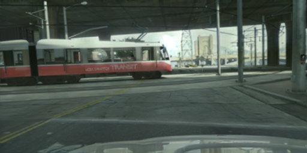
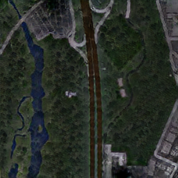
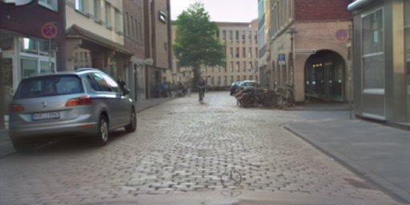
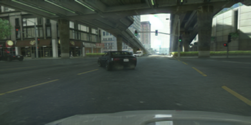
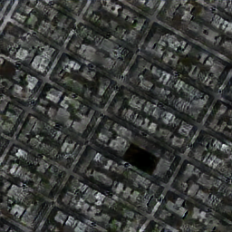
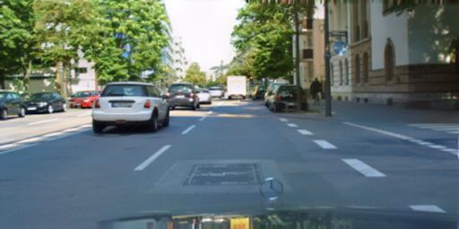
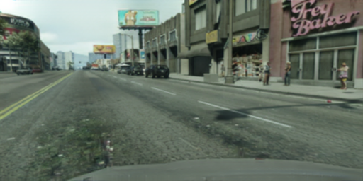
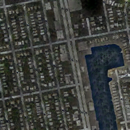
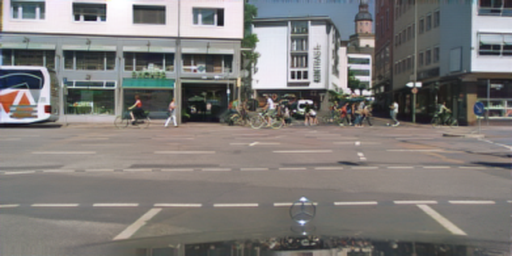

# Unpaired Image Translation Based on Vector Symbolic Architecture and Dual Attention Mechanism

Official PyTorch implementation of **DaVSAIT**.

**Hongqian Chen**<sup>1,3</sup>, **Jiahui Xiong**<sup>1,3</sup>, **Xiaochuan Wang**<sup>1,3</sup>, **Hui Li**<sup>2,*</sup>

<sup>1</sup> School of Computer and Artificial Intelligence, Beijing Technology and Business University, Beijing, China<br>
<sup>2</sup> Management College, Beijing Union University, Beijing, China<br>
<sup>3</sup> Beijing Key Laboratory of Big Data Technology for Food Safety, Beijing Technology and Business University, Beijing, China<br>
<sup>*</sup> Corresponding author: lihui@buu.edu.cn

[[Paper]](#) (under review) · [[Pretrained models]](../../releases) · [中文说明](README_zh.md)

## Overview

To address detail loss and semantic flipping in unpaired image translation when the source and target domains differ significantly in semantics, DaVSAIT introduces a **dual attention mechanism** into VSA-based adversarial learning ([VSAIT](https://github.com/facebookresearch/vsait), ECCV 2022):

- **Multi-spectral channel attention** (following FcaNet) captures inter-channel dependencies and enhances texture and boundary details.
- **Self-attention** (following SAGAN, learnable γ initialised to 0) captures long-range spatial dependencies and improves global consistency.

The model consists of three parts: a generator **G<sub>att</sub>** with dual attention (`models/generators.py`), a hyper-vector encoder **E** (VGG19 features + LSH projection, `models/feature_extractor.py`, `models/lsh.py`), and a bidirectional reversible mapping network **R** (2-layer MLP, `models/iit.py`). Training uses a hyper-vector adversarial loss and a hyper-vector cycle-consistency loss (`losses/da_loss.py`).

## Results

### GTA → Cityscapes

| Method | KID ↓ | FID ↓ | pxAcc ↑ | clsAcc ↑ | mIoU ↑ |
|---|---|---|---|---|---|
| DRIT | 14.69 | 67.46 | 64.28 | 32.17 | 20.99 |
| GcGAN | 12.32 | 91.43 | 65.62 | 32.38 | 22.64 |
| CUT | 21.18 | 74.63 | 64.59 | 32.19 | 20.35 |
| SRUNIT | 16.27 | 104.36 | 67.21 | 32.97 | 22.69 |
| VSAIT | 8.74 | 63.00 | 76.48 | 45.33 | 30.89 |
| **DaVSAIT (Ours)** | **6.19** | **53.20** | **79.12** | **45.89** | **31.02** |

### Google Maps ↔ Aerial Photo

| Method | A→M Dist ↓ | A→M FID ↓ | A→M pxAcc(30) ↑ | A→M pxAcc(50) ↑ | M→A Dist ↓ | M→A FID ↓ | M→A pxAcc(30) ↑ | M→A pxAcc(50) ↑ |
|---|---|---|---|---|---|---|---|---|
| DRIT | 24.19 | 265.75 | 13.94 | 29.01 | 70.87 | 203.21 | 28.97 | 43.56 |
| GcGAN | 23.62 | 90.08 | 15.00 | 30.65 | 71.47 | 71.09 | 28.87 | 43.48 |
| CUT | 23.44 | 68.81 | 16.25 | 31.34 | 70.28 | 81.58 | 28.86 | 44.07 |
| SRUNIT | 23.00 | 147.42 | 17.67 | 32.78 | 68.55 | 202.83 | 30.41 | 45.91 |
| VSAIT | 22.86 | 77.02 | 15.20 | 32.13 | 64.98 | 127.66 | 45.30 | 69.28 |
| **DaVSAIT (Ours)** | **21.25** | **68.77** | 16.88 | 32.46 | 65.12 | 103.20 | 40.90 | 61.79 |

### Ablation (GTA → Cityscapes)

| Multi-spectral CA | Self-attention | pxAcc | clsAcc | mIoU |
|:---:|:---:|---|---|---|
| × | × | 76.48 | 45.33 | 30.89 |
| × | ✓ | 76.94 | 45.47 | 30.93 |
| ✓ | × | 78.57 | 45.61 | 30.98 |
| ✓ | ✓ | **79.12** | **45.89** | **31.02** |

### Qualitative results

| GTA → Cityscapes | Google Maps ↔ Aerial Photo | Cityscapes → CBCL |
|:---:|:---:|:---:|
|  |  |  |
|  |  |  |
|  |  |  |

## Repository structure

```
DaVSAIT/
├── configs/            # model / data / augmentation yaml files
├── data/               # datasets, loaders and augmentations
├── losses/             # hyper-vector adversarial + cycle-consistency losses
├── models/             # dual-attention generator, discriminator, LSH, reversible mapping
├── options/            # command-line arguments
├── utils/              # config system and logger
├── scripts/            # train / test commands for every task
├── datasets/           # put datasets here (not tracked, see datasets/README.md)
├── docs/imgs/          # qualitative results
├── solver.py           # PyTorch-Lightning training / validation / test loop
├── train.py
├── test.py
└── verify_gpu.py       # quick CUDA + forward/backward sanity check
```

## Installation

Tested with Python 3.8.13, PyTorch 1.10.0 (CUDA 11.3), PyTorch-Lightning 1.5.9 on a single NVIDIA RTX 3090.

```bash
git clone https://github.com/<chenhong-hu>/DaVSAIT.git
cd DaVSAIT
conda create -n davsait python=3.8 -y
conda activate davsait
pip install torch==1.10.0+cu113 torchvision==0.11.1+cu113 -f https://download.pytorch.org/whl/torch_stable.html
pip install -r requirements.txt
python verify_gpu.py      # optional sanity check
```

## Datasets

See [datasets/README.md](datasets/README.md).

## Training

| Task | Data config | Model config | Aug config | λ | Epochs |
|---|---|---|---|---|---|
| GTA → Cityscapes | `gta2cityscapes.yaml` | `vsait.yaml` | `gta2cityscapes_aug.yaml` | 10 | 20 |
| Google Maps → Aerial | `maps2aerial.yaml` | `maps_model.yaml` | `square256_aug.yaml` | 5 | 400 |
| Aerial → Google Maps | `aerial2maps.yaml` | `maps_model.yaml` | `square256_aug.yaml` | 5 | 400 |
| Cityscapes → CBCL | `cityscapes2cbcl.yaml` | `vsait.yaml` | `gta2cityscapes_aug.yaml` | 10 | 20 |

```bash
bash scripts/train_gta2cityscapes.sh
bash scripts/train_maps2aerial.sh
bash scripts/train_aerial2maps.sh
bash scripts/train_cityscapes2cbcl.sh
```

Common settings: batch size 1, Adam (β1 = 0, β2 = 0.9), lr 1e-4 for the generator / mapping network and 4e-4 for the discriminator, halved every 100k iterations, hyper-vector dimension 4096.
Resume with `--resume_from_checkpoint <path/to/ckpt>`. Checkpoints and TensorBoard logs are written to `./checkpoints/<name>/`.

## Pretrained models

Download from the [Releases](../../releases) page and put them in `./pretrained/`:

| Task | File |
|---|---|
| GTA → Cityscapes | `davsait_gta2cityscapes.ckpt` |
| Google Maps ↔ Aerial Photo |`davsait_maps.ckpt`, `davsait_aerial.ckpt` |
| Cityscapes → CBCL | `davsait_cityscapes2cbcl.ckpt` |

## Evaluation

```bash
bash scripts/test_gta2cityscapes.sh
bash scripts/test_maps2aerial.sh <path/to/checkpoint.ckpt>
bash scripts/test_aerial2maps.sh <path/to/checkpoint.ckpt>
bash scripts/test_cityscapes2cbcl.sh
```

Translated images are saved to `./test_results/<name>/images/`.

## Citation

```bibtex
@article{chen2026davsait,
  title   = {Unpaired Image Translation Based on Vector Symbolic Architecture and Dual Attention Mechanism},
  author  = {Chen, Hongqian and Xiong, Jiahui and Wang, Xiaochuan and Li, Hui},
  journal = {Under review},
  year    = {2026}
}
```

## Acknowledgement

This work was supported by the National Natural Science Foundation of China (No. 62307001).
The code is built on [VSAIT](https://github.com/facebookresearch/vsait) (Theiss et al., ECCV 2022). Please also cite:

```bibtex
@inproceedings{theiss2022unpaired,
  title     = {Unpaired Image Translation via Vector Symbolic Architectures},
  author    = {Theiss, Justin and Leverett, Jay and Kim, Daeil and Prakash, Aayush},
  booktitle = {European Conference on Computer Vision (ECCV)},
  pages     = {17--32},
  year      = {2022}
}
```

## License

This project is derived from VSAIT and is released under the same [CC-BY-NC 4.0 License](LICENSE) (non-commercial use only).
